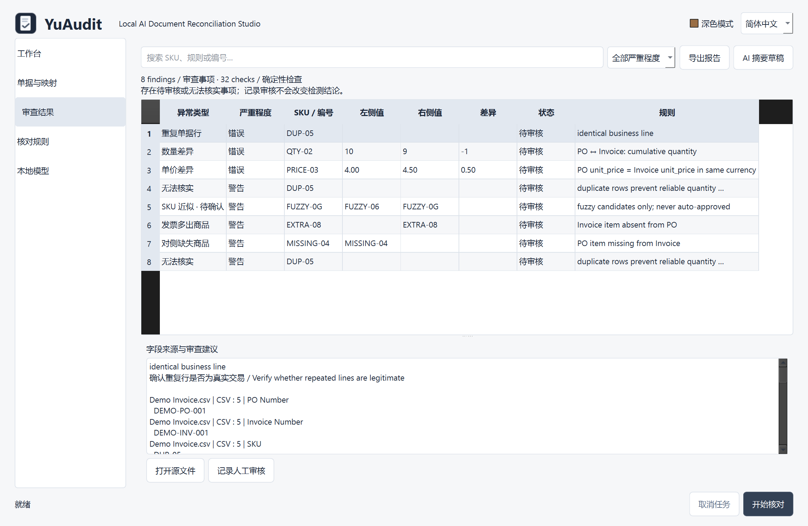

# YuAudit
### Local AI Document Reconciliation Studio

[GitHub](https://github.com/HongyuLeo/YuAudit) · [Downloads / 下载](https://github.com/HongyuLeo/YuAudit/releases/tag/v0.1.0) · [AI / maintainer handoff](PROJECT_HANDOFF.md)


An offline Windows desktop workspace for procurement, supply-chain, finance and trade teams to reconcile purchase orders, commercial invoices and packing lists. Version **0.1.0**.

[简体中文](README.zh-CN.md) · [Release notes](CHANGELOG.md) · [Third-party notices](THIRD_PARTY_NOTICES.md)



Screenshots are captured from the running application. [English dark theme](docs/screenshots/en-dark-2.png).

## Install
Download `YuAudit-Windows-x64.zip`, extract the **entire folder**, and launch `YuAudit-Windows-x64/YuAudit.exe`. No Python, Node.js, login, subscription or API key is needed. Windows 10/11 x64 is the target; see `docs/VERIFICATION.md` for the actually tested environment. The executable is not digitally signed.

## Workflow
1. Choose **Load demo data**, or import `.xlsx`, `.csv` and text-table `.pdf` files. Drag-and-drop and multi-file selection are supported.
2. Confirm document types, edit column mappings and correct cells in Documents & mapping. Changes never modify source files. Identifiers must be text in Excel if leading zeros matter.
3. Mark a file partial only when its **entire business scope** represents a partial invoice or shipment. Multiple invoice references in a file are supported.
4. Run reconciliation. Filter and sort findings, inspect cell provenance and source locations, open source files and record review notes.
5. Export Excel, UTF-8 BOM CSV or JSON. Excel includes Summary, Exceptions, Structured data and Evidence sheets. Decimal values are exported as strings to retain exact precision.

The preview shows the first 500 rows. Larger files are fully checked (100,000 data rows per file); edit rows outside the preview by correcting a copy of the source and re-importing. Local last-session recovery and settings are stored under `%LOCALAPPDATA%\YuAudit`. Delete that directory to remove saved business data. Exported reports also contain business data.

## Deterministic controls
- Explicit PO references scope matches; packing also requires explicit invoice references. Missing references are never guessed.
- Exact/normalized identifiers precede constrained fuzzy candidates. Fuzzy matches are **never automatically accepted**. Resolve them by manually correcting the identifier and rerun.
- PO, invoice and SKU aliases are checked across each document-kind namespace, including separate imported files. If multiple raw identifiers collapse to one key, the affected matches and aggregates are blocked for review. A single unambiguous spelling on each side still supports normalized matching. Punctuation-only identifiers never match, even with normalization disabled.
- Quantity differences, unit prices, quantity × price, declared totals, duplicate rows, repeated invoice identifiers across files, missing/extra items and reference mismatches have evidence-backed findings.
- Decimal arithmetic with 64-digit working precision; inputs support up to 20 significant digits and 8 fractional places. Financial/quantity tolerances are configurable.
- Different or missing currencies block financial comparisons. No exchange-rate conversion is implemented.
- Cumulative batches are aggregated within their PO/item scope. Partial shortfalls remain **unverified balances**, not false passes. Over-shipments remain exceptions.
- Duplicate or ambiguous lines block reliable aggregation. Review notes do not rewrite deterministic conclusions.
- An empty result means only **no exceptions in the checked scope**, not a legal or financial certification.

## Optional local AI
Install Ollama and a suitable model separately, then enable Local AI and enter the installed model name. Only loopback HTTP endpoints are accepted. No model is downloaded automatically. Column mapping advice and summary/explanation drafts are validated with Pydantic schemas and shown separately. Users apply mappings manually. AI cannot alter reconciled values or rules. AI drafts in reports are explicitly labeled unverified. No live Ollama model is required for core functionality.

## Architecture
| Layer | Module |
|---|---|
| Desktop UI / background tasks | `yuaudit/ui.py` |
| CSV, read-only Excel, text PDF | `yuaudit/parsers.py` |
| Typed schema / evidence | `yuaudit/models.py` |
| Column aliases / standardization | `yuaudit/normalize.py` |
| Independent deterministic audit | `yuaudit/engine.py` |
| Optional provider protocol / Ollama | `yuaudit/ai.py` |
| Atomic session storage / bounded logs | `yuaudit/storage.py` |
| Atomic exports / formula protection | `yuaudit/reports.py` |
| Chinese / English resources | `yuaudit/i18n.py` |

Python 3.12 + PySide6 provides native desktop controls, responsive worker tasks and a stable Windows directory package. openpyxl, pdfplumber and Pydantic supply tested format parsers and schema validation. No browser runtime or server is needed.

## Develop and build
```powershell
py -3.12 -m venv .venv
.venv\Scripts\python -m pip install -r requirements-dev.txt
.venv\Scripts\python -m pytest -q
.venv\Scripts\python scripts/create_assets.py
.venv\Scripts\python -m yuaudit
./scripts/build.ps1 -Python .venv\Scripts\python.exe
```
The build script tests, collects license texts, packages via PyInstaller, starts the **real packaged executable** through its UI demo flow, exports three reports and captures a screenshot before creating the ZIP. `.github/workflows/windows.yml` repeats this on Windows GitHub Actions. Windows GitHub Actions completed successfully: [verified run](https://github.com/HongyuLeo/YuAudit/actions/runs/37767230908).

```powershell
$env:YUAUDIT_DATA_DIR = "$PWD/build/test-profile"
dist/YuAudit-Windows-x64/YuAudit.exe --smoke-test build/manual-smoke --language en
```

## Demo and limitations
All sample records are fictional. `demo/EXPECTED.md` specifies normal, quantity, price, missing/extra, duplicate, fuzzy and cumulative-batch scenarios. Tests exercise these expectations.

PDF support requires recognizable ruled tables with a header on each table/page. Scanned PDFs fail explicitly: OCR is **not included**. Free-form PDF extraction, inline rendered PDF viewer, automatic tax/discount recognition, credit notes, unit-of-measure conversion, exchange rates, arbitrary spreadsheet header-row selection, full-row GUI pagination and automatic AI matching are not implemented. Numeric comma means thousands separator, never decimal separator. Excel formula cells require saved cached values. Blank values remain missing. Supplier/date fields are extracted but are not independently validated. Cancellation is cooperative at parse/row/group boundaries; native PDF/Excel calls or local AI requests may take time to return (AI timeout 60 seconds).

## Open source
YuAudit code is MIT. Qt/PySide6 and other bundled components retain their own licenses; see notices and the generated `THIRD_PARTY_LICENSES` directory. Qt libraries are dynamically distributed, not statically linked. Keep redistribution notices and license texts with the application. Models are not included; review their licenses independently.

To publish: create an empty GitHub repository, commit this source directory excluding `.gitignore` entries, push, inspect the Windows Actions result, and attach the ZIP and SHA-256 checksum to a `v0.1.0` release. Never commit imported business files, local profiles, logs, model weights or credentials.
